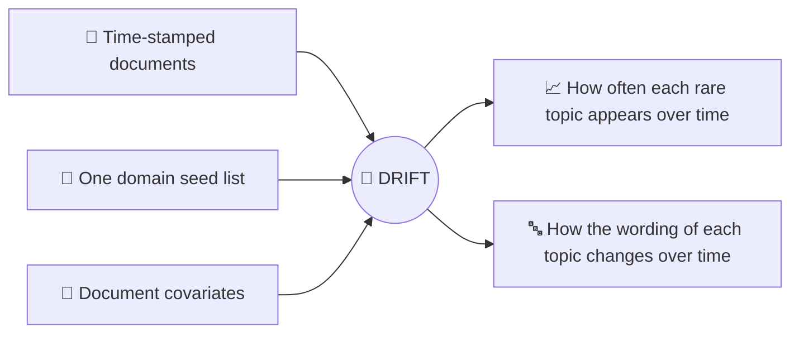

<h1 align="center">🌊 DRIFT</h1>

<p align="center">
  <b>Constrained Dynamic Topic Models for Weak-Signal Trend Discovery</b>
</p>

<p align="center">
  Seyedeh Fatemeh Ebrahimi · Jaakko Peltonen<br>
  <i>Transactions on Machine Learning Research (TMLR), 2026</i>
</p>

<p align="center">
  
  
  
</p>

---

## 🔍 Why DRIFT?

Some meaningful themes in large text collections are also rare. Think of mental-health talk in everyday YouTube comments: it is a small part of the conversation, it comes and goes, and the words people use for it change over time.

Standard topic models recover the dominant topics, and existing extensions add either temporal dynamics or domain guidance, but rarely both. DRIFT brings the two together.

## ✨ Key ideas

- 🌱 **One seed list for the whole domain.** You give a single list of seed words, without saying which word belongs to which topic.
- ⚖️ **Seed-mass floor.** Each minority topic keeps a minimum share of its probability on the seed words.
- 🔽 **Less weight where it does not belong.** Minority topics get a lower weight in documents without seed words.
- ⏳ **Change over time.** Topic prevalence changes through document covariates, and topic content through a random walk.
- ✅ **Constraints by construction.** Both constraints are built into the model instead of being added as penalties, so every distribution stays a valid probability distribution.
- 🧮 **Variational EM.** The model is fitted with variational EM and reparameterized Monte Carlo estimates.

## 🗺️ DRIFT at a glance



## 📊 Main findings

- On a synthetic benchmark with known ground truth, DRIFT outperforms standard static, dynamic and constrained baselines on rare-trend identification, topic-content quality and temporal recovery.
- Its advantage in identification and temporal recovery holds in two settings where the temporal prevalence patterns differ from the model's assumptions.
- In a case study on YouTube comments from Finnish mental-health-related vlog channels, where no ground truth is available, DRIFT recovers mental-health discussion trends in a qualitative evaluation.

## 🔒 Data and privacy

The real-data case study uses public YouTube comments from Finnish mental-health-related vlog channels. We do not share the comments, user names or any other individual-level information.

## 📄 Citation

If you find this work useful, please cite:

```bibtex
@article{ebrahimi2026drift,
  title   = {{DRIFT}: Constrained Dynamic Topic Models for Weak-Signal Trend Discovery},
  author  = {Ebrahimi, Seyedeh Fatemeh and Peltonen, Jaakko},
  journal = {Transactions on Machine Learning Research},
  issn    = {2835-8856},
  year    = {2026}
}
```

## 📬 Contact

Questions and feedback are welcome. Open an issue or email Mona Ebrahimi (seyedeh.ebrahimi@tuni.fi).
